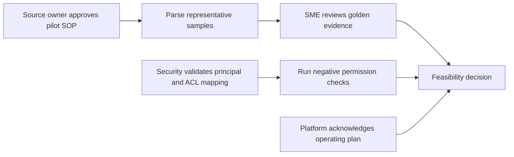

# Ask Halyard decomposition memo
## Decision requested
Approve a timeboxed feasibility spike for one ops-policy workflow: "What is our demurrage policy for Felixstowe?"
## Evidence and uncertainties
### Evidence
Sources: HF-BRIEF-01, HF-INT-01 and data-inventory.md.
### Blockers
Current SOP authority and production identity remain unvalidated.
### Risks
* Owners not able to clean up data
  - Likelihood: Low
  - Impact: High - cannot answer if we can't find the right document
  - Mitigation: Make sure sample data is close to real data and they answer in first week
  - Trigger to reconsider: Cannot tell us how they plan to clean up the data early
* Owners can't give us a way to find the policy truth with multiple conflicting documents if we can't look at the data or filename
  - Likelihood: Medium
  - Impact: High - cannot answer without a standard to know which one is right
  - Mitigation: Make sure they answer this in the first week
  - Trigger to reconsider: Cannot answer or list a lot of exceptions that keep growing
* The ingestion having trouble reading the documents
  - Likelihood: Low-medium
  - Impact: High - cannot answer without human reading document
  - Mitigation: Make sure sample data is close to real data
  - Trigger to reconsider: Cannot read text of a document type/format that is common
## Options
Existing search clean-up; permission-aware RAG; ticket-model tuning.

Scale: 1 (poor) to 5 (strong).

| Option | Evidence availability | Safety | Ease of Integration | Ease of Operational | Measurable value | Uncertainty |
|---|---|---|---|---|---|---|
| Existing search and source clean-up (non-AI) | 4 | 3 | 2 | 2 | 4 | High (owners not confirmed) |
| Permission-aware RAG | 4 | 4 | 1 | 1 | 5 | High (Lots of unknowns) |
| Ticket-model tuning | 3 | 1 | 2 | 2 | 1 | High (tickets aren't source of truth) |

Finding that would favour the non-AI option: 

If the spike finds that the biggest issue was the sources not being organized and conflicts were everywhere (which would have to get corrected either way) and once the were fixed it would be a quick search for the user most of the time. 
## Recommended thin slice
Read-only policy lookup with source page and safe abstention.
## Work breakdown
Approve source -> parse sample -> test ACL -> draft eval cases.

Parsing success cannot compensate for failed permission checks.

| Work package | Owner | Exit criterion |
|---|---|---|
| Source owner approves pilot SOP | Tom | Tom formally confirms the demurrage SOP is current |
| Parse representative samples | FDE | Each sample is parsed correctly |
| Security validates principal and ACL mapping | Security lead | Security lead formally confirms the ACL file is up to date |
| Run negative permission checks | FDE | All permission tests pass |
| SME reviews golden evidence | SME | SME formally confirms given evidence is correct |
| Platform acknowledges operating plan | FDE with Platform team | Platform formally agrees to operate the pilot |
## Dependencies and owners
Tom: policy authority; Lena: access review; platform: operating model.
## Stop and continue rules
Stop on leakage or unapproved egress; continue only with approved evidence.
## Estimate and next decision
| Item | Detail |
|---|---|
| Timebox | 2 weeks |
| Range | 4-7 days on engineering and 4-7 days on gathering data/answers needed |
| Assumptions | We can get answers in 1 week |
| What would make it larger | Conflicting data not resolved, unreadable documents |
| Evidence required | Exit criteria met |
| Review date | End of week 2 |
| Next decision | Is it feasible?|

## Friday-demo failure exercise

### Scenario
The approved SOP has no reliable page text, Tom (source owner) is unavailable, and the sponsor still wants a demo on Friday.

### Decision
I would then look at the approved SOP documents with the demurrage policy for Felixstowe and create readable, synthetic text documents from them and work from that. During the demo I will call out explicitly that this was done so they know it's not possible with current documents. 

### How it's presented
- It uses documents based off the approved SOP documents but manually fixing issues and changing important data
- The data used is not the same data given to us because that wasn't usable

### What we won't do
- Claim Tom approved the SOP
- Claim it will work with current data
- Present it as connected to Halyard's real systems

### Next steps
- When Tom is back we'll figure out how to get reliable documents
- Try different methods of document reading (only had time to try one or two before demo)

### Canvas impact
The first slice can stay the same and just be pushed by a week as long as the readability issues get worked out. 
